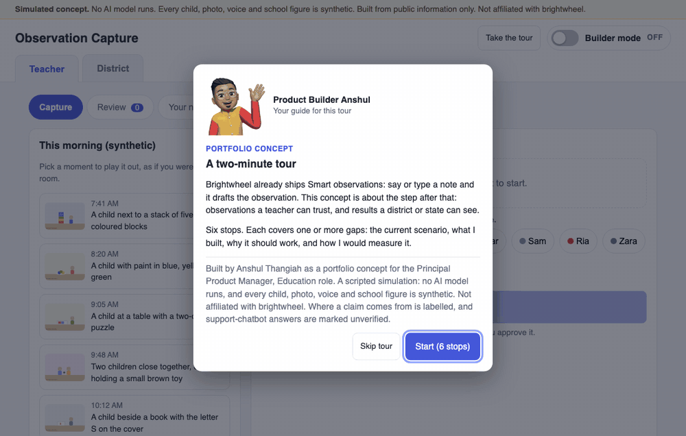

# Observation Capture

**Observations a teacher can trust and a state can see.**

An independent product concept for early-learning software: a spec and a working demo. It is not affiliated with brightwheel, and was built from public information without access to any brightwheel system.

**[Try the live demo](https://anshulthangiah.github.io/brightwheel-observation-capture/)** (opens a short guided tour)

Current version: **v1.1.0**. Release notes are in [CHANGELOG.md](CHANGELOG.md). The problems fixed and still open are in [Known issues and backlog](#known-issues-and-backlog).



## The problem, in short

Voice drafting already makes early-learning observations quick to write. What comes after drafting is still open:

- A suggested skill comes with no reason, so a teacher cannot tell why it was chosen.
- The photo is added after drafting and plays no part in the suggestion.
- Suggestions ignore a child's earlier benchmarks, so a big jump or two teachers disagreeing goes unnoticed.
- Coverage is a report the teacher has to go and open, not a nudge while capturing.
- Notes about an injury or illness are treated like any other, and families see observations by default.
- Assessment reports are per site and PDF only, so a district or state sponsor cannot combine or export the evidence.

The first five hit a teacher at 7:25 with nine toddlers arriving. The last one decides whether a state will pay for assessments at all. The gaps document lists 15 gaps one by one. Each has its source and the tour stop that shows it, so you can see the fix in the demo. Two gaps are marked as not in the demo: [`docs/CURRENT_STATE_AND_GAPS.md`](docs/CURRENT_STATE_AND_GAPS.md).

## Who it is for

| User | What they need |
|---|---|
| Lead teacher (main user) | Fast capture she can trust and does not have to second-guess |
| Program director | To know which children and rooms are not being observed |
| District or state sponsor | To show what a year of funding bought |
| Parent | Accurate, appropriate updates. Sensitive notes never reach the family feed by default |

## Why a model helps here, and where it must stop

Teachers write free text and take photos. Matching one note to one of 73 skills by hand is slow, so a model that proposes a skill and a benchmark is a good fit. The risk is a wrong suggestion sitting in a child's record. So the design rules are:

- The model proposes. The teacher confirms. It never sets a child's level on its own.
- Every suggestion shows its reason: the words said and what the photo shows.
- A photo can support a suggestion. It can never create one alone.
- A jump of two or more levels needs a check and can never be bulk-approved.
- Notes about injury or illness are never mapped. They stay Staff only and go to an incident record.
- When it is not sure, it says so and leaves the choice to the teacher.

In this demo **no AI model runs.** Transcripts, photo tags and suggestions are scripted, and the matcher is keyword rules. The demo shows the workflow, the guardrails and the feel. It does not show production accuracy.

## How I tested the rules (evals)

The demo has no AI model, so I tested the part that stands in for one: the keyword rules that suggest a skill and flag sensitive notes. This tests the stand-in rules, not a model. I used the method I would use on a real model, so the same cases can score one later.

**The method**

1. Write 20 tricky notes: injuries, harmless look-alikes ("fell asleep"), negation ("did not count"), unusual wording, and one case that should get no suggestion.
2. Write down the right answer for each note, with a reason, before looking at what the rules do.
3. Keep a frozen copy of the original rules, so the "before" score cannot drift.
4. Improve the rules using only 14 of the notes. Hold 6 back and never change a rule to fix one of them. Those 6 show whether the fixes carry over.
5. After tuning, try new sentences that are not in either set, and report what still fails.
6. One command reproduces every number: `cd demo && npm run evals`.

**The results**

| | Before | After |
|---|---|---|
| Tuning cases passed (14) | 4 | 14 |
| Held-out cases passed (6) | 1 | 5 |
| Injury, illness or safeguarding notes flagged | 2 of 6 | 6 of 6 |
| Harmless look-alike notes wrongly flagged | 5 of 5 | 0 of 5 |

**What changed in the rules.** They now catch wording like "threw up", "nosebleed", "her dad hits her" and "fell off". They also stop flagging "fell asleep", "hit the drum" and "fall leaves", and they ignore evidence the child did not produce ("did not count"). All 10 scripted demo moments behave exactly as before, and a test checks that.

**What the evals found that I have not fixed.** One held-out case still fails: the rules count one phrase as two pieces of evidence, so the demo's own Maya example shows High confidence when it should be Medium. A short probe after tuning also found four injury and safeguarding notes the rules miss entirely. These are in the [backlog](#known-issues-and-backlog) below.

**How far to trust the numbers.** Twenty cases is a worked example of the method, not a measurement. I wrote both the rules and the cases, and I wrote the held-out cases after seeing how the rules failed, so the held-out set is weaker than a blind one. [`evals/README.md`](evals/README.md) has the full method, every case in [`evals/RESULTS.md`](evals/RESULTS.md), and what the numbers do not prove.

## What is in scope, and what is not

**In scope for this concept**

1. Capture with photo and voice, with children picked from the names spoken.
2. A suggested skill and a separate benchmark for each child, with a "why" line.
3. The earlier benchmark, who gave it and when, and a check step when a new one jumps 2 or more levels.
4. A coverage nudge at capture, and a safety route for sensitive notes.
5. An end-of-day review with undo, and a district view of evidence quality with a CSV export.

**Left out on purpose**

- Replacing the teacher's judgment on a child's level.
- Screening or diagnosing a child, or telling parents a child is "behind".
- Parent-facing home activities and any consumer pricing (a separate concept).
- Child outcomes in the district view, until the evidence quality is shown to be consistent.
- A real AI model. The demo is a scripted simulation.

## How I would measure it

Every target is an assumption to test in a pilot. The full list is in the spec.

| Measure | Pilot target (assumption) |
|---|---|
| Seconds from opening the camera to a saved draft | Under 10 |
| Minutes a teacher spends in review per day | Under 3 |
| % of drafts approved without changes (High confidence) | At least 70% |
| % of High-confidence drafts with the wrong skill, in a 200-note sample | Under 10% |

## What the demo shows

A scripted simulation. Nothing is typed and no AI model runs.

0. **Tour and Builder mode.** A cartoon guide, Product Builder Anshul, walks you through. He appears only in the tour, its welcome and wrap-up cards, and the Builder mode legend, never inside the product screens. The first visit opens a six-stop tour. Each stop has four rows: Current scenario, What I built, Why it should work, How I would measure it. "Take the tour" replays it. The **Builder mode** switch pins numbered markers on the live screens, and tapping one opens its stop card. Add `?notour` to the address to skip the tour.
1. **Two views.** **Teacher** (open by default, with Capture, Review and Your numbers beneath it) and **District** (a separate sponsor-facing view).
2. **Capture.** Pick a moment, tap the shutter, tap to record. The transcript appears, the photo is "read", and the children are picked from the names spoken. Select a child the note does not mention and it asks whether to keep or remove them.
3. **Choose who sees it.** An explicit "Who can see this once logged?" choice (Families and staff, or Staff only) at capture and again in review.
4. **Explain.** Each suggested skill says why: the words said, and what the photo shows.
5. **Check.** Each child gets their own benchmark, shown beside the last one, who gave it and when.
6. **Nudge.** The matched skill shows how many children have an observation in this window and who has none.
7. **Route.** Notes about injury or illness are never mapped, are locked to Staff only and go to an incident record.
8. **Review.** An end-of-day queue with undo, and a completion screen that lists who has no observation yet.
9. **Edit and delete.** Before a draft is logged you can edit what was heard, change who it is about, start over, or discard it. Saving an edit asks "Save these changes?" first, shows before and after, and warns if the note names different children from the ones selected. Editing re-runs the same keyword rules on the new words. It is not an AI model, and the screen says so.
10. **District.** Made-up site figures for evidence quality, with a CSV export.

## What is in here

| Path | What it is |
|---|---|
| [`spec/SPEC.md`](spec/SPEC.md) | The product spec: starting point, rules, scope, metrics, evaluation plan, business case, 90-day validation plan, and sequence diagrams of the key user journeys |
| [`docs/CURRENT_STATE_AND_GAPS.md`](docs/CURRENT_STATE_AND_GAPS.md) | How the current flow works, with a source and confidence label for every claim, and 15 gaps, each mapped to the tour stop that shows it (or marked as not in the demo) |
| `demo/` | The working browser demo, with synthetic children, photos, voices and school figures |
| `demo/guide-content.js` | All the words for the tour and Builder mode: six stop cards, one source of content |
| `demo/guide-common.js`, `demo/tour.js`, `demo/builder.js` and their `.css` files | The reusable guide kit: Take a Tour and Builder mode. The same code runs in my other projects |
| `evals/` | 20 tricky test notes for the keyword rules, scored before and after tuning, with the results and where they still fail. See [`evals/README.md`](evals/README.md) |
| `demo/tests/` | 69 automated tests of the rules, the framework structure, the trust logic, the review logic and the tour and Builder mode content |
| `demo/tests-ui/` | Real-Chromium tests: the prototype flow (76 checks), the tour and Builder mode on this product (131 checks), and a generic test of the guide kit that includes three phone sizes (120 checks) |
| [`CHANGELOG.md`](CHANGELOG.md) | Release notes for each version, newest first. The GitHub Release for each version uses the same text |
| `docs/assets/demo-tour.gif` | The animation at the top of this page. Made by `demo/make-gif.js` from the live demo |

## Run the demo

**Easiest way:** open the live demo link at the top of this page. Nothing to install.

**To run it on your own computer**, you need Node 18 or newer and Python 3. There is no install step, no API key and no internet needed. Developed and tested with Node 25.

The demo is a few plain web files (HTML, CSS, JavaScript). Double-clicking `demo/index.html` usually works too (checked in Chromium). The local web server below is the safer route, because it behaves like a real website, which is how the live demo runs.

```bash
cd demo                           # go into the demo folder
python3 -m http.server 8765       # start a local web server on port 8765 (Python is used only for this)
# then open http://localhost:8765 in your browser. Stop the server with Ctrl+C.
```

To run the tests:

```bash
cd demo
node --test                       # fast checks of the matching rules, review logic and tour text. Needs nothing installed
```

The next set is optional. It opens a real (hidden) Chromium browser and clicks through the demo like a person would, which catches screen bugs the fast tests cannot:

```bash
npm install                       # downloads the Playwright test tool
npx playwright install chromium   # downloads the browser it controls
npm run test:browser              # the prototype flow: capture, review, edit, district
npm run test:tour                 # the first-run tour and Builder mode on this product
npm run test:guide                # the generic guide-kit test, including phone sizes
```

The demo uses pre-made synthetic photos and voice notes that are already in `demo/media/`. To regenerate them (macOS only, since it uses the built-in `say` voice and `ffmpeg`): `cd demo && node make-media.js`. To remake the animation (needs `ffmpeg` and the Playwright step above): `cd demo && node make-gif.js`.

## Honest limits

- The AI is simulated. Transcripts, photo tags and benchmarks are scripted per moment, and the matcher is keyword rules. The demo shows the workflow, the guardrails and the feel, not production accuracy.
- Skill names and codes come from the published Experience Developmental Continuum of Skills (© Experience Early Learning Co.), names only, with attribution. Benchmark descriptors are not reproduced. The keyword rules that stand in for the AI are mine, and only some skills have them.
- The demo rates at skill level with benchmarks 0 to 8 and does not use age bands, because the published age bands overlap the benchmark columns.
- All children, photos, voices, schools and numbers are synthetic. Every target in the spec is an assumption to validate.
- The district view shows evidence quality, not child outcomes, on purpose.
- Several gaps rest on support-chatbot answers, which can be wrong. The gaps document labels each one.
- The keyword rules still miss some injury and safeguarding wording and still flag a few harmless notes. See the backlog below and the evals folder.

## Known issues and backlog

This section tracks problems by ID. Every release updates it. Fixed lists what has shipped, newest version first. Open lists what is still to do. A problem I find goes into Open with an ID. When it is fixed it moves to Fixed with the version number. IDs never change. Priority is my proposal. Release notes for each version are in [CHANGELOG.md](CHANGELOG.md).

### Versions

| Version | What it contains |
|---|---|
| [v1.1.0](CHANGELOG.md#v110) | Fixes for phone screens and unclear labels, a rebuilt gaps document with each gap mapped to its tour stop, a rewritten README with a demo animation, and an evals folder with tuned keyword rules. 69 automated tests. |
| [v1.0.0](CHANGELOG.md#v100) | First public release: the product spec, the gaps document, the demo with a guided tour and Builder mode, and 63 automated tests. |

### Fixed

| ID | Issue and how it was found | What changed | Fixed in |
|---|---|---|---|
| B09 | **Tour spotlight in the wrong place on phones.** Reported from the mobile view. A rule meant for wide screens also applied on phones, which pushed the page to 404 px wide on a 375 px screen. | The rule now applies to wide screens only. A new test checks every stop on three phone sizes (375x667, 390x844, 412x915) and fails if the spotlight misses its feature, the card hides it, something sticks out past the screen edge, or Next is off screen. The generic kit test grew from 98 to 120 checks. | v1.1.0 |
| B10 | **Review controls ran off the edge of phone screens.** Found while measuring B09 at four phone widths. | The row of controls now wraps, and each dropdown fits the screen. | v1.1.0 |
| B11 | **District table wider than a phone screen.** Found in the same measurement. | The table scrolls sideways inside its own box, and the tour highlights the box. | v1.1.0 |
| B12 | **The "Today" row label was unclear on the tour cards.** Raised in review. | Renamed "Current scenario" in the tour, the Builder mode cards, the spec and the tests. | v1.1.0 |
| B13 | **Builder mode called tour stops "Gap 1 to 6", which clashed with the gap numbers in the gaps document.** Found while mapping gaps to stops. | Now "Stop 1 to 6" everywhere in Builder mode. A test fails if "Gap" comes back. | v1.1.0 |
| B14 | **Gap counts did not agree.** The demo and spec said six, the gaps document had nine rows, and the numbers did not match. Raised in review. | The gaps document now lists 15 gaps one by one, each with its source, a status (11 addressed, 2 partly, 2 not built) and the tour stop that shows it. A second table maps each stop to its gaps. G12 and G15 are marked "Not in the demo". The tour welcome now says "one or more gaps". | v1.1.0 |
| B15 | **The README read like a file list, not a product brief.** Raised in review. | Rewritten: the problem, who it is for, why a model helps and where it must stop, what is in scope and left out, how to measure it, and honest limits. | v1.1.0 |
| B16 | **No quick visual in the README.** | A 35-second animation made from the live demo by `demo/make-gif.js`. | v1.1.0 |
| B17 | **Injury, illness and safeguarding wording missed by the rules.** Found by the evals: only 2 of 6 such notes were flagged. | Wording added ("threw up", "nosebleed", "her dad hits her", "fell off"). Now 6 of 6 on the eval notes. See B02 for what is still missed. | v1.1.0 |
| B18 | **Harmless notes flagged as sensitive** ("fell asleep", "hit the drum", "fall leaves"). Found by the evals: 5 of 5 look-alike notes were wrongly flagged. | The rules now look for a person being hit, or someone falling down or off something. Now 0 of 5 on the eval notes. See B03. | v1.1.0 |
| B19 | **Things the child did not do counted as evidence** ("did not count" suggested counting). Found by the evals. | Negated actions no longer count, except "didn't give up", which still counts as persistence. See B04 for two cases it gets wrong. | v1.1.0 |
| B20 | **Unusual wording not matched** ("tripod grasp", "a really big tall tower"). Found by the evals. | The rules now match them. | v1.1.0 |
| B21 | **No tests for tricky notes.** | New evals folder: 20 notes (14 for tuning, 6 held out), a frozen copy of the original rules, a scoring script, results, and a README that says what the numbers do not prove. Unit tests rose from 63 to 69. A test checks that tuning left all 10 demo moments unchanged. | v1.1.0 |
| B22 | **The spec's metrics used "share" and "domain".** Raised in review against the project's copy rules. | Now "%" and "learning area". | v1.1.0 |

### Open

B01 to B04 were found while building the evals for v1.1.0. B05 to B08 are known limits of the work so far.

| ID | Issue and how it was found | Why it matters | Proposed next step | Priority |
|---|---|---|---|---|
| B01 | **One phrase counted as two pieces of evidence.** Found by eval case H06, then confirmed in the demo's own Maya moment. "Asked what happens if we add red" and "what happens if" are the same words matched by two rules, so the first skill shows High. | The spec says High needs two or more pieces of evidence. Here one phrase reaches High, so a teacher may trust the suggestion more than the evidence supports. | Count overlapping phrases once. The Maya skill becomes Medium, so the tour, tests and demo animation need a small update. | High |
| B02 | **Injury and safeguarding wording the rules miss.** A probe with new notes found four with no flag: "scraped his knee", "a really bad tummy ache", "scared to go home tonight" and "his uncle plays rough games that he does not like". | A missed safeguarding note costs far more than a false alarm. | Add words for the first two. The last two need reading for meaning, which a keyword list cannot do. They need a model or a person, and a safe default of flagging a note when unsure. | High |
| B03 | **Harmless notes still flagged.** "Fell over laughing", "threw up her hands" and "hit her goal of ten stickers" were all flagged as sensitive. | A false alarm sends a harmless note to the incident record and hides real learning evidence. | Narrow the rules, or let the teacher dismiss a flag with one tap and a visible reason. | Medium |
| B04 | **Negation rule too strong.** "Didn't just count, he counted to ten" and "could not stop jumping" both lost real evidence. | A real observation gets no suggestion. | Handle "didn't just" and "could not stop" as positive. | Low |
| B05 | **The test sets are small and not blind.** 20 notes, written by the author of the rules. | The scores flatter the rules. | Grow to the spec's 200 labelled notes and a 100-note safety set, labelled by educators who did not write the rules. | Medium |
| B06 | **No real model has been scored.** | The demo cannot show how a model would behave on these notes. | Write a wrapper that returns the same shape as the rules, and score it with `run-evals.js` next to the rules. | Medium |
| B07 | **Gaps not fully covered by the demo.** G12 (director approval) and G15 (a sponsor purchasing model) are not in the demo. G06 (two teachers rating differently) and G09 (reminders) are only partly covered. See the [gaps document](docs/CURRENT_STATE_AND_GAPS.md). | Some of the problems the spec describes are not yet shown. | Decide which to build next from the 90-day plan in the spec. | Medium |
| B08 | **Not tested on a real phone.** The v1.1.0 phone fixes (B09 to B11) were checked on three emulated phone sizes only. | An emulator can miss touch and browser quirks. | Open the live demo on a phone and report what looks wrong. | Medium |

License: MIT for the code and documents. The mascot images in `demo/assets/` are a personal avatar of the author, are not covered by the MIT licence, and may not be reused.
