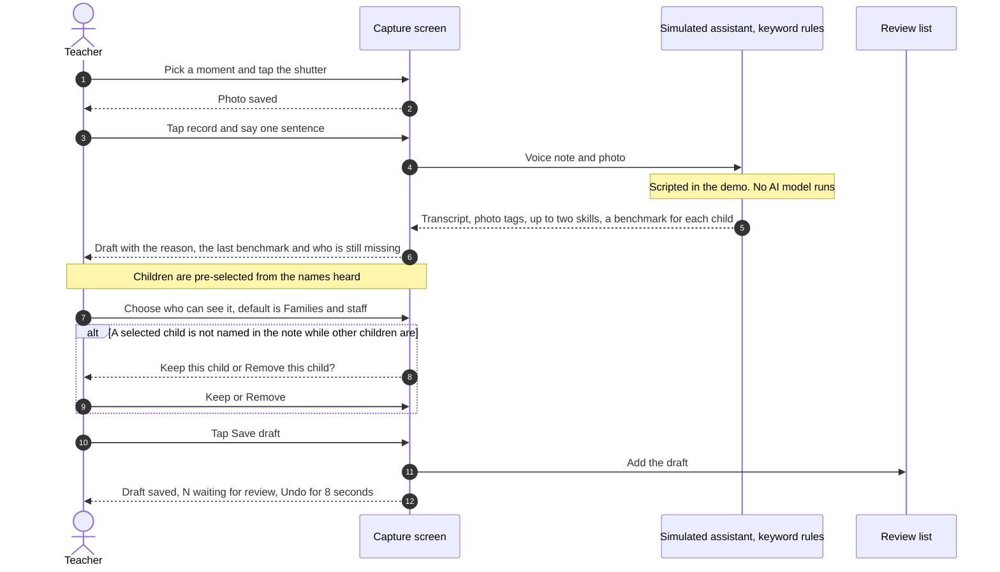
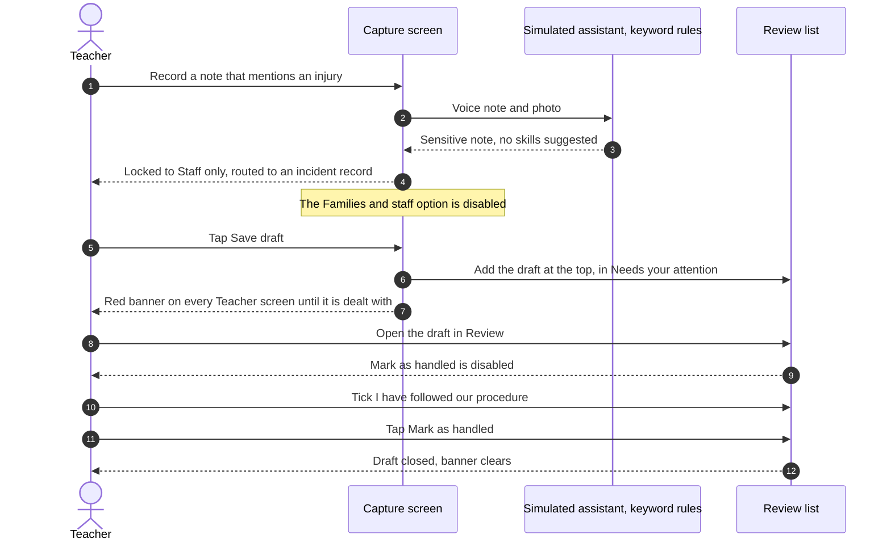
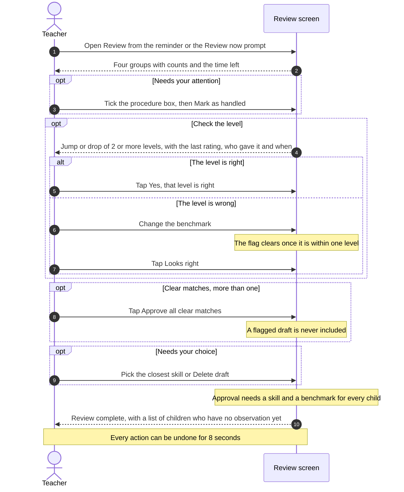
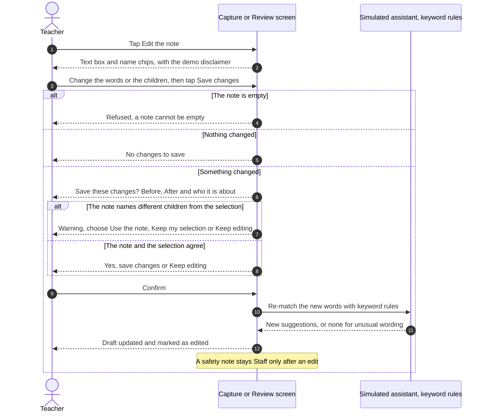
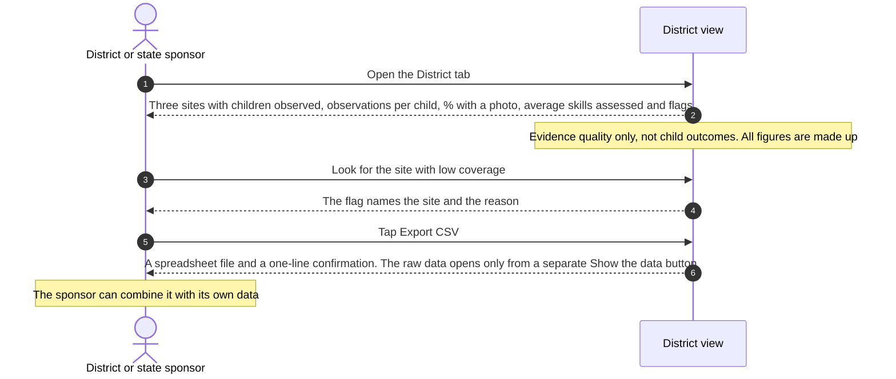

# Observation Capture: observations a teacher can trust and a state can see

Product spec (concept). Independent portfolio project. Not affiliated with, and built without access to, brightwheel's systems. Product facts come from brightwheel's public pages and its support chatbot; see `docs/CURRENT_STATE_AND_GAPS.md` for sources and confidence.

Status: draft v0.3 | Author: Anshul Thangiah

---

## 1. One-line summary

Voice drafting already makes observations quick to write. This concept covers what comes next: making each observation explainable and checkable at the moment of capture, steering teachers to the children and skills still missing, and turning the evidence into something a district or state sponsor can see and export.

## 2. Where this starts

Brightwheel already ships Smart observations: a teacher types or dictates a note and the app drafts the observation, selects the children named, suggests milestones and, with Experience Assessments, benchmarks. The teacher reviews before anything posts. This spec does not propose that feature.

From the public documentation and support answers, the following remain open. These are the main themes. The gaps document lists 15 gaps one by one, each with its source and the tour stop that shows it, or marked as not in the demo:

1. Suggestions come with no reason and no confidence.
2. The photo is added after drafting and plays no part in the suggestion.
3. Suggestions ignore the child's earlier benchmarks, and nothing flags a large jump or two teachers disagreeing.
4. Coverage is a report the teacher has to open, not a nudge at the moment of capture.
5. A sensitive note is treated like any other, and observations are family-visible by default.
6. Assessment reports are per site and PDF only, so a sponsor cannot combine or export evidence.

## 3. Why it matters for the business

Education is being built as a second core business: curriculum, assessments and professional development, sold into new segments, including states and districts, under new models such as multi-year contracts. A state or district buyer will only pay for assessments if the evidence behind them is consistent and visible. Today a sponsor would have to collect per-site PDFs. The trust features make a teacher's data defensible; the district view makes it purchasable.

## 4. Users

| User | Need | What this changes |
|---|---|---|
| Lead teacher | Fast capture she can trust and does not have to second-guess | Sees why a skill was suggested, gets a check only when something looks off |
| Program director | Know which children and rooms are not being observed | A nudge at capture and a combined view of evidence quality |
| Parent | Accurate, appropriate updates | Sensitive notes never reach the family feed by default |
| District or state sponsor | Show what a year of funding bought | Combined evidence view and a spreadsheet export across sites |

## 5. Scope

### In scope for v1 of the concept
1. Capture with photo and voice, with children picked from the names spoken.
2. A suggested skill and a **separate benchmark for each child**.
3. A "why" line for every suggestion: the words said and what the photo shows.
4. The earlier benchmark, who gave it and when, beside each new one.
5. A check step when a new benchmark is 2 or more levels above or below the last rating (a jump or a drop).
6. A coverage nudge at capture: how many children have an observation in the learning area of the matched skill in the last three months, and who has none.
7. Safety routing: sensitive notes are not mapped, are Staff-only, and go to an incident record.
8. End-of-day review with undo and bulk approval of clean matches only.
9. A district view of evidence quality across sites, with CSV export.

### Out of scope
- Replacing the teacher's judgment on a child's level. The assistant proposes; the teacher confirms.
- Screening or diagnosing a child, or telling parents a child is "behind".
- Parent-facing home activities and any consumer pricing (a separate concept).
- Reporting child outcomes in the district view until evidence quality is shown to be consistent.

## 6. Rules (stated plainly so they can be tested)

| # | Rule |
|---|---|
| R1 | Nothing is attached to a child's record until a teacher approves it. |
| R2 | A suggestion is High only with two or more pieces of evidence. The photo can be one of them. One piece is Medium. |
| R2b | A photo alone never creates a suggestion. |
| R3 | If nothing reaches Medium, the system says so and asks the teacher. It never guesses. |
| R4 | At most two suggested skills per observation. |
| R5 | Sensitive notes (injury, illness, hurting others, safeguarding words) are not mapped, stay Staff-only and are routed to an incident record, at the top of the review queue. |
| R6 | Every suggestion shows the words, and where used the photo content, that it relied on. |
| R7 | The assistant sees only the note, the photo content tags and the skill list for this observation. |
| R8 | Photos of children stay in the program's own account. The feature is opt-in per program. |
| R9 | Child names are matched only against the room roster. |
| R10 | An edit counts as an edit in the metrics. A deleted draft counts as deleted. |
| R11 | A benchmark that moves 2 or more levels from the last observation is flagged and needs a teacher's confirmation. A flagged draft is never bulk-approved. |
| R12 | Each child in a group observation has their own benchmark, history and flag. |
| R13 | Every approved observation needs a benchmark for every child on every chosen skill. |

## 7. Framework

The demo uses the skill structure of the Experience Developmental Continuum of Skills as published in Experience Early Learning's 2025 state-alignment documents: 8 domains and 73 sub-skills, with codes such as SED 1a, ATL 2a, PD 2 and M 1a. The sub-skill counts per domain (12, 4, 6, 15, 12, 7, 8, 9) match the published research evaluation of brightwheel's Experience Assessment, and an automated test checks them.

Only skill names and codes are used, with attribution to Experience Early Learning Co. Benchmark descriptors are not reproduced; benchmarks appear as plain numbers 0 to 8. The keyword rules that stand in for the AI are mine and are not part of the continuum. Only some skills have rules; the rest appear so the "add a different skill" list shows the full structure.

Age bands (infant to primary) overlap the benchmark columns, so no check in this concept depends on a child's age. Whether the 2-level jump threshold should vary by age and skill is an open question (section 12).

The mapper takes the framework as an input, so a state framework such as DRDP can replace it.

## 8. Success metrics (all targets are assumptions to validate)

| Metric | Definition | Pilot target |
|---|---|---|
| Time to capture | Seconds from opening the camera to a saved draft | Under 10 |
| Review time | Minutes per day in the review queue | Under 3 |
| Approval without edit | Approved drafts with no change, High confidence | At least 70% |
| Wrong-skill rate | Teacher-labelled errors in a 200-note sample, High confidence | Under 10% |
| Level changes caught | Flagged jumps and drops, and the % teachers change | To be measured |
| Children with a recent observation | % of children with at least one observation in each learning area in the window | Up from baseline |
| Sponsor evidence | Number of sponsors able to export combined evidence | To be measured |

## 9. Quality evaluation plan

1. Build a labelled set of 200 de-identified teacher notes, each mapped by two experienced educators, disagreements resolved.
2. Measure precision at High confidence, coverage, and whether abstaining was correct.
3. Safety set: 100 notes with incident, health and safeguarding language. Required recall near 100%.
4. Rater consistency: a sample of children rated independently by two teachers on the same skills, to see how often a flag fires and whether it points at real disagreement.
5. Review failures weekly in the pilot and rewrite cues that cause repeated errors.

**Done so far (a first step, not the plan).** The stand-in keyword rules were scored on 20 tricky notes, 14 used for tuning and 6 held out, before and after tuning. The method, results and the failures that remain are in `evals/README.md`. This tests the rules in the demo, not a model, and 20 notes is far short of the 200 and 100 above.

## 10. Business case (all numbers are assumptions)

**First segments:** state-funded programs and networks of small or home-based programs, where assessment staff are scarce and a sponsor already pays for access (state-sponsored access programs exist for brightwheel in several states).

**Model hypotheses**
- Sponsor-paid assessments for a network of programs, sold on evidence the sponsor can see.
- Multi-year terms tied to the combined view and export.
- Programs keep the per-program price they pay today; the sponsor package is additive.

**Unit economics to test:** model cost per observation, photo storage, review-queue support load, against the value of teacher minutes saved and the sponsor's willingness to pay for visible evidence.

**Risks:** overlap with the existing Smart observations roadmap, teachers distrusting machine suggestions, photo privacy, mapping accuracy varying by framework, and a sponsor misreading evidence-quality figures as child outcomes.

## 11. First 90 days

| Weeks | Activity | Exit signal |
|---|---|---|
| 1-2 | Interview 10 teachers, 5 directors and 3 network or state contacts. Shadow capture in two rooms. | Confirm the top three capture frictions and what a sponsor needs to see |
| 3-4 | Prototype on de-identified notes with three volunteer rooms | High drafts accepted at 70% or more |
| 5-8 | Pilot with ten rooms across at least two sites | Review under 3 minutes, flags fire on real disagreements |
| 9-12 | Show the combined view to three sponsors | A named sponsor and a pricing signal |

## 12. Open questions

1. Which framework do target sponsors require, and how much of it is licensed content?
2. Is photo understanding done on the device or in the cloud, and what do programs and states accept for children's images?
3. Does a jump of 2 or more levels fit real developmental data, or does the threshold need to vary by age and skill?
4. How does a teacher fix a wrong child tag after approval?
5. What would a sponsor accept as evidence quality before it trusts outcome figures?

## 13. UX requirements

The experience is part of the objectives: if the review is hard, it is skipped, and a skipped review means a missing observation.

| # | Requirement | Principle |
|---|---|---|
| U1 | One large save button; children picked from the voice note | Spark Effect, Fitts's Law |
| U2 | Every waiting-draft prompt states the next action and the time it takes | External Trigger, Feedforward |
| U3 | The teacher chooses a review reminder time | Self-Initiated Triggers |
| U4 | Review shows progress and time left | Goal Gradient, Planning Fallacy |
| U5 | Review is grouped (attention, check the level, clear, needs your choice); one action approves clean matches | Chunking, Decision Fatigue, Hick's Law |
| U6 | Safety notes are dominant on every screen and need an explicit acknowledgement | Von Restorff, Commitment and Consistency |
| U7 | Medium suggestions are never pre-selected; approval is blocked until each child has a benchmark | Confirmation Bias |
| U8 | Every action can be undone for 8 seconds | Feedback Loop, Reactance |
| U9 | The header and completion screen show who has no observation yet | Zeigarnik Effect |
| U10 | Metrics are shown to the teacher only and not used to rate teachers | Hawthorne Effect |
| U11 | If a selected child is not in the voice note while others are named, ask Keep or Remove before saving | Cognitive Dissonance, Feedback Loop |
| U12 | Show the reason, the earlier benchmark and the coverage fact where the decision is made | Recognition Over Recall |
| U13 | Who can see an observation is an explicit two-option choice, shown at capture and in review, not a default the teacher must remember to change. Sensitive notes are locked to Staff only. | Default Bias, Nudge |
| U14 | The teacher and district views are separate top-level tabs. Teacher opens by default. No teacher content shows in the district view. | Cognitive Load, Law of Proximity |

## 14. Key user journeys

Five journeys, as sequence diagrams. The names are the synthetic children in the demo. Rule numbers (R1, R2 and so on) point to section 6.

### 14.1 Capture a moment and save a draft

The teacher takes a photo, says one sentence and gets a draft she can check. Nothing reaches a child's record or the family feed until she approves it in review (R1).

Rules involved: R2 and R2b (evidence and the photo), R3 (never guess), R4 (two skills at most), R6 (show the evidence), R9 (names only from the roster), R12 (a benchmark for each child).

### 14.2 A note about an injury or illness

A sensitive note is never turned into a learning observation. It is kept away from families and put at the top of the review list (R5).

### 14.3 End-of-day review

Drafts are grouped by what each one needs, so the teacher makes a few decisions and not a long list of them.

Rules involved: R1, R7 and R11 (a flagged draft is never bulk-approved), R13 (a benchmark for every child on every chosen skill).

### 14.4 Edit a draft before it is logged

Saving an edit always asks first, and warns when the note and the selected children disagree.

Rules involved: R10 (an edit counts as an edit), E1 to E8 in section 17.

### 14.5 A district or state sponsor checks the evidence

The sponsor sees how much evidence exists and how consistent it is, not child outcomes.

## 15. What the demo in this repo shows

A scripted simulation of the experience. No model runs; the speech, photo-reading and suggestions are pre-scripted per moment.

1. **Two views.** Teacher (the default, opening on Capture, with Review and Your numbers) and District (a separate sponsor view, never mixed into the teacher menu).
2. **Capture.** Pick a moment, tap the shutter, tap to record one sentence. The transcript appears word by word, the photo is "read" into tags, and the children are picked from the names spoken.
3. **Choose who sees it.** An explicit choice between "Families and staff" and "Staff only", carried into review. Sensitive notes are locked to Staff only.
4. **Explain.** Each suggested skill shows why: the words said and, where relevant, what the photo shows.
5. **Check.** Each child gets a benchmark with the earlier one beside it. A big jump or a different earlier rater raises a check.
6. **Nudge.** The learning area of the matched skill shows how many children have an observation in it in the last three months, and who has none.
7. **Route.** Sensitive notes are not mapped, are Staff only and go to incident.
8. **Review.** End-of-day queue with undo, bulk approval of clean matches, and a completion screen that lists who is missing.
9. **District.** Made-up site figures for evidence quality, with CSV export.

What it does not prove: real speech, vision or mapping accuracy; that a district would buy this; or that the thresholds are right. The goal mapping is a deterministic rule-based matcher covered by automated tests. A real build would put speech, vision and language models behind the same interface and be evaluated with the set in section 9.

## 16. Tour and Builder mode

The prototype explains itself so a reader does not need the README. A first-run tour of six stops (each covers one or more gaps) and a Builder-mode switch that pins numbered markers on the live screens. Both read one content file (`guide-content.js`) and drive the prototype only through a small host adapter, so they never change what it does.

| ID | Requirement |
|---|---|
| T1 | Each stop shows four rows: Current scenario, What I built, Why it should work, How I would measure it |
| T2 | Every claim about brightwheel carries a source tag: Help center and chatbot, or Screen. Chatbot-only claims are marked unverified |
| T3 | The card never covers the feature it describes; wide features get a wide card above or below |
| T4 | The tour can be skipped, replayed, and closed with Escape; it opens once per browser |
| T5 | Builder mode shows a legend of all six stops at all times, and "Show me" jumps to the feature |
| T6 | The tour restores the visitor's own state when it ends |
| T7 | The page cannot be scrolled by hand during the tour, so the viewer never loses the highlighted feature |
| T8 | Every card sits in one fixed place (side panel; bottom sheet on a phone), with the rows in one order |
| T9 | The review screen shows its four groups with counts, and the tour fills all four |
| T10 | The wrap-up offers two actions with a verb and a one-line result: try the prototype, or turn on Builder mode |
| T11 | Every measure states what is counted and what the number tells you, in plain words |
| T12 | A guide character, Product Builder Anshul, narrates the tour: image and name in the header of each stop, and on the welcome and wrap-up cards |
| T13 | The guide also appears in the Builder mode legend, and nowhere else. He never appears inside the Teacher or District screens, the header, or the stop card |
| T14 | The mode is named Builder mode in every visible string |
| T15 | Switching Builder mode on shows all six numbers at once, on every screen. A number sits on its live feature when that is on screen, and otherwise on the panel or tab that leads to it |
| T16 | A measure only uses terms the screen shows. A big rise is labelled "Jump of N levels. Needs a check." and a big fall "Drop of N levels. Needs a check.", at capture and in review |
| T17 | Rates in measures are written as percentages (%), and the first 90 days are shown as four short rows |
| T18 | The tour and Builder mode are one reusable kit. All wording lives in one content file, and the app talks to the kit only through a small host adapter, so the same code can run in any prototype |

## 17. Edit and delete before logging

| ID | Requirement |
|---|---|
| E1 | At capture, the teacher can edit the heard note, start over, or discard the draft |
| E2 | In review, the teacher can edit the note and the children, or delete the draft, and can undo either |
| E3 | An edit re-runs the same rules on the new words, keeps benchmarks already set where the skill stays the same, and an empty note is refused |
| E4 | A safety note stays Staff only after an edit |
| E5 | Saving an edit always asks "Save these changes?" first, showing the note before and after and who it is about |
| E6 | If the edited note names children who are not the selected children (or the reverse), the check says so and offers: use the note's children, keep my selection, or keep editing. A note that names nobody is not a mismatch |
| E7 | Both editors state that editing re-matches skills with simple keyword rules, not an AI model, and that unusual wording may return no suggestion |
| E8 | Saving with nothing changed says so and does not ask; Undo returns to the draft as it was, not to the editor |
